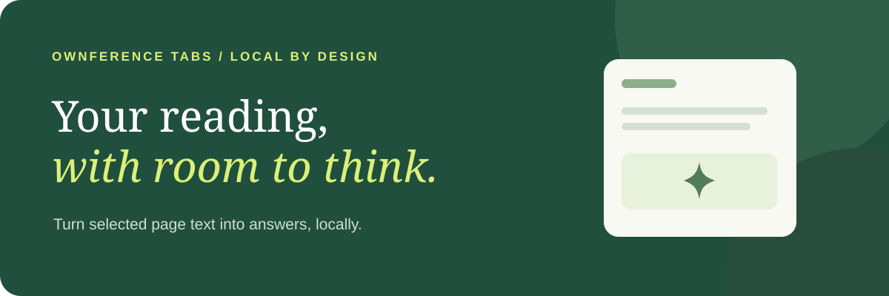
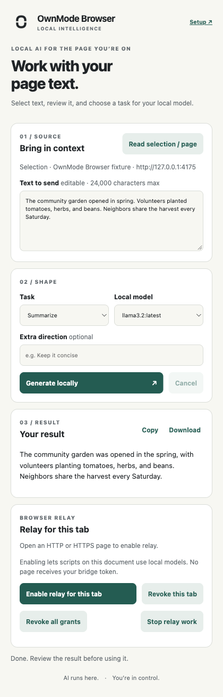

# OwnMode Browser

**Switch to your own AI.**

Local intelligence for your apps and browser.

Select text, review what will be sent, then summarize, rewrite, extract, compare or draft with your own model. Cooperating web apps can also request local inference after you approve their tab.

[](https://github.com/edwinjosechittilappilly/ownmode-browser/actions/workflows/ci.yml)
[Apache-2.0](LICENSE) · [Install](#install) · [Browser relay](#let-a-web-app-use-your-models) · [Issues](https://github.com/edwinjosechittilappilly/ownmode-browser/issues/new/choose)

## Install

Requires **Chrome** and a running [OwnMode Connect](https://github.com/edwinjosechittilappilly/ownmode) with a ready local model. The Apple-native provider requires Apple hardware and macOS 26; other providers have their own requirements.

### Download and load

1. [Download the extension ZIP](https://github.com/edwinjosechittilappilly/ownmode-browser/releases/download/v0.3.0/ownmode-browser.zip) and extract it into a folder you will keep. The ZIP is unsigned and is not a Chrome Web Store listing.
2. Open **chrome://extensions** and enable **Developer mode**.
3. Choose **Load unpacked**, select that folder and pin OwnMode Browser.

No GitHub account or npm needed for the extension ZIP. This is an unpacked extension, **not a Chrome Web Store listing**. Never disable browser security.

### Or use npx

With **Node 24+**, copy it into an empty durable directory:

```sh
npx --yes --package https://github.com/edwinjosechittilappilly/ownmode-browser/releases/download/v0.3.0/ownmode-browser-0.3.0.tgz ownmode-browser install --directory "$HOME/Applications/OwnModeBrowser"
```

Load that directory in Chrome. It survives the npx cache. For a durable CLI:

```sh
npm install -g https://github.com/edwinjosechittilappilly/ownmode-browser/releases/download/v0.3.0/ownmode-browser-0.3.0.tgz
ownmode-browser path
```

`path` prints a durable content-addressed extension directory. ZIP and keyed npm installations can have different Chrome IDs; always use the actual ID from Setup.

## Your first useful result

1. Open **Setup**. Run its exact-origin grant command in a terminal with OwnMode Connect installed.
2. Paste the one-time token into Setup and save.
3. Select text on a regular HTTP(S) page. Open OwnMode Browser and choose **Read selection / page**.
4. Review the editable source preview. Pick a task and a local model; **Generate locally**.
5. Review the result, then **Copy** or **Download**.



*A deliberate path from selected text to a local result. No background scraping or automatic page edits.*

Keep the action popup open while generating; closing it interrupts that request. With no selection, capture uses visible body text. Password fields are refused and source text is capped at 24,000 characters.

## Let a web app use your models

The relay lets a **cooperating frontend** use local compute without receiving your bridge token.

1. Open Setup and copy its native-host installation command. It uses your actual extension ID:

   ```sh
   ownmode native install --extension-id YOUR_CHROME_EXTENSION_ID
   ownmode native status
   ```

2. Open the cooperating website.
3. Open OwnMode Browser, check the displayed origin and choose **Enable relay for this tab**.
4. Use that website's Connect action.

**Page → approved document channel → extension → native host → bridge → model.**

Use **Revoke this tab**, **Revoke all grants** or **Stop relay work** whenever you want. Developers integrate [`createRelayClient()` from OwnMode Web](https://github.com/edwinjosechittilappilly/ownmode-web#add-local-ai-to-your-app).

The extension does not replace a website's existing backend AI or give model output permission to click, buy, send email or execute tools.

## Upgrading from Ownference

Upgrade Ownference Bridge, Web and Tabs together to OwnMode Connect, Web and Browser; their relay identifiers are not compatible across versions. Before removing the old runtime, run its `ownference native uninstall` and, if enabled, `ownference startup uninstall` to remove the old native host and startup service. Then install the new extension, register its actual Chrome ID with `ownmode native install --extension-id YOUR_CHROME_EXTENSION_ID`, and issue a fresh direct grant in Setup. Re-enable relay for each trusted tab; old grants and tokens are not imported.

<details>
<summary>Permissions, sessions and revocation</summary>

- `activeTab` and `scripting`: capture/relay only after extension-owned user action; no always-on all-sites listener.
- `storage`: session credentials/grants, not synchronized prompt history.
- `nativeMessaging`: the extension talks to the installed host; the website cannot call it directly.
- Loopback host permission: the assistant uses `127.0.0.1:3210`.
- Relay is limited to the current top-level HTTP(S) document. Internal pages and cross-origin frames are restricted.

Validated grants can survive ordinary worker idleness; live work is never replayed after a lost connection. Navigation or revoke cancels work; browser/extension restart clears session grants. Re-enter a securely retained assistant token or issue a fresh grant after a session reset.

Revoke a direct extension grant with `ownmode revoke --origin chrome-extension://YOUR_CHROME_EXTENSION_ID`. Remove the native host with `ownmode native uninstall`.

Approve only trusted sites: their other same-origin scripts share access, and they can transmit generated output elsewhere. No cloud fallback or automatic website mutation. Prompt injection and incorrect answers remain possible.

</details>

## Help make local AI useful

Share a page workflow that saves you time, report a capture issue or suggest a better preset. [Open an issue](https://github.com/edwinjosechittilappilly/ownmode-browser/issues/new/choose); omit private page content and credentials.

```sh
npm ci
npm run check
npm run package
npx playwright install chromium
npm run e2e
```

E2E requires sibling `ownmode` and `ownmode-web` checkouts and real Ollama. It drives genuine extension action/activeTab grants and the same popup document in a tab because Playwright cannot expose Chrome's transient toolbar popup. Packaging verifies an explicit asset list, required icons/license, no development public key in the ZIP and reproducible archive bytes.

[Architecture](docs/architecture.md) · [Relay design](docs/browser-relay-plan.md) · [Testing](docs/testing.md) · [Verification](docs/verification.md) · [Brand assets](docs/assets/README.md) · [Contributing](CONTRIBUTING.md) · [Security](SECURITY.md)

**Switch to your own AI.** [Connect](https://github.com/edwinjosechittilappilly/ownmode) · [Web](https://github.com/edwinjosechittilappilly/ownmode-web) · [Browser](https://github.com/edwinjosechittilappilly/ownmode-browser) · [Mac](https://github.com/edwinjosechittilappilly/ownmode-mac)

Apache-2.0. Distribution uses GitHub releases, not the npm registry or Chrome Web Store. SHA256SUMS accompanies releases. No trademark clearance is claimed.
