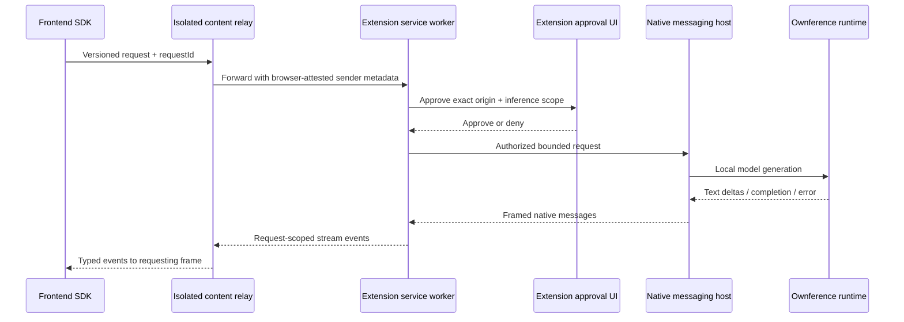

# Browser relay: local compute for frontend applications

Status: **planned, not implemented**. Requested as an additional idea while the direct-loopback SDK and page assistant were being built. This plan does not replace or claim completion of the existing products.

## Positioning

**Ownference Relay — Your website. Their models.**

A frontend calls a browser extension that mediates access to the visitor's local models. Keep this as a separate module within Ownference Tabs initially, with a separately packaged extension/repository only if permission, lifecycle or distribution requirements diverge. This avoids a fourth install and premature duplicate bridges. The existing `ownference-web` SDK is the developer entry point; a future transport selector can offer direct loopback or relay explicitly. Neither transport can intercept unrelated websites' backend LLM calls.

## Intended architecture

Prefer native messaging for the extension-to-host transport, so hosted pages do not need direct loopback access or a copied bearer token. This requires a real installed native host and a narrowly registered extension allowlist. A website alone cannot access Apple's Swift framework or native messaging. The current HTTP bridge remains useful for direct integration and diagnostics; no unauthenticated native forwarding endpoint may be added.

## Public interface proposal

A future `createRelayClient()` should retain the SDK's task/model/stream shapes and add explicit `connect()`/`disconnect()` and connection status. Requests are not sent until a user asks to connect. Connection discovery reveals only extension availability, not the user's model inventory, until approved.

Transport messages:

- `hello`: protocolVersion and fresh connection nonce.
- `connect`: request ID, requested scope (`models`, `generate`) and requested session lifetime; the extension derives the real origin, tab and frame.
- `models`: request ID after approval.
- `generate`: request ID and the existing bounded task/model/text/instruction request.
- `cancel`: same connection, frame and request ID; cannot cancel another site's work.
- `delta`, `done`, `error`: version, request ID and payload, exactly one terminal event.
- `disconnect`: revoke that active connection and abort its work.

No arbitrary URLs, local files, shell commands, tool names, OS actions, email sending or purchases in the initial scope. Embeddings, background agents and file access require separate future capability designs, not inference permission inheritance.

## Security invariants

1. **Origin identity:** use `sender.origin`, `sender.tab.id`, `sender.frameId` and `sender.documentId` from the browser. A page-supplied `origin` is never trusted. Refuse opaque/null origins, sandboxed frames, browser/internal URLs and unapproved subframes. Default top-level frames only.
2. **Page relay:** validate `event.source === window`, `event.origin === location.origin`, protocol version and a strict size/schema before forwarding. Page code is inherently untrusted, including other scripts on an approved origin; nonces correlate messages but do not make same-origin malicious scripts trustworthy.
3. **Narrow installation:** request site access only after an explicit user action; avoid an always-on `<all_urls>` content script. Prefer optional host permissions per approved site. No externally callable `generate` endpoint without the same approval checks.
4. **Permission ownership:** approval happens in extension-owned UI, never an imitation dialog rendered by the website. Show exact origin, available scope, selected provider/model, expected compute limits and session lifetime. Default session-only; persistent grants are opt-in, inspectable and revocable.
5. **Secret confinement:** website scripts never receive runtime grant tokens. Native host manifests permit only this extension ID; do not trust claimed website origins from the host payload without extension-owned approval state.
6. **Isolation:** bind requests to the initiating document; navigation, tab close, extension disconnect or revocation cancels work. Do not route a response to a replacement document with a reused frame ID.
7. **Resource control:** per-site and global concurrency, input/output limits, bounded queue, timeout and cancellation; user-visible compute indicator and Stop all button. Deny background workloads by default.
8. **Privacy:** return results only to the initiating connection/frame. Once returned, the website can transmit them. Model names may fingerprint users; reveal only after permission. No prompts or response content in logs/telemetry.
9. **No model-authorized privilege:** generated text never grants permissions, executes actions or changes routing policy. Treat page text and output as untrusted.
10. **Local-only routing:** provider endpoints remain loopback and native Apple model selection remains on-device. No silent cloud fallback through a future transport adapter.

## Lifecycle and compatibility

Chrome MV3 service workers can suspend. A native messaging connection may affect lifetime, but lifetime behavior must be verified for supported browser versions, not assumed. The protocol needs a disconnection terminal error, not automatic replay of generation; replay could duplicate actions or compute. Use explicit user retry. Keep active connection state inspectable from the extension UI.

Safari/Firefox require their own extension/native transport packaging and permission validation. Do not advertise them until exercised. Enterprise policy can prohibit native messaging or extension installation. UI should explain the missing host, missing permission, provider unavailable and blocked-by-policy cases separately.

## Acceptance before implementation can be called complete

- A real HTTPS frontend connects through the installed extension/native host without receiving a bridge token or fetching localhost directly.
- Allow/deny, per-origin isolation, subframe rejection, navigation/document replacement, revoke and cancel are tested through actual extension behavior.
- Real Ollama generation streams through page → relay → native host → runtime → page; Apple availability and LM Studio are separately verified.
- A hostile second site and a crafted page message cannot use an existing grant, enumerate models, receive another request's output or cancel its work.
- Browser restart, service-worker suspension, host exit and model failure return explicit terminal errors without replaying requests.
- Bounded requests/backpressure are tested under concurrent origins; UI Stop all reliably aborts provider work.
- Protocol fixtures/version compatibility, host installer/uninstaller, signed packaging where required, privacy disclosure and onboarding docs ship together.
- Independent security review is completed before making externally reachable relay features available.

## Delivery order

1. Freeze protocol and threat model against the existing bridge interface.
2. Implement native host registration and extension-only transport, with installer/uninstaller and isolated tests.
3. Implement approval UI and document-scoped request registry.
4. Add frontend SDK relay adapter and one HTTPS cooperating example.
5. Run real multi-origin abuse tests and Ollama browser acceptance, review findings, package and document observed support.

This is planning only. The current Ownference Tabs manifest intentionally has no website message listeners or native-messaging permission. Those must not be silently added under the guise of a documentation change.
